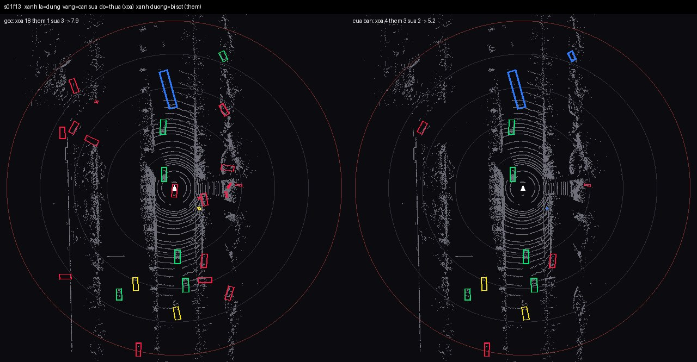

# Báo cáo Day 14 — <Họ và tên> — <MSSV>

> Sao chép file này thành `report/individual/<MSSV>_<HoTen>.md` (không dấu), ví dụ `2A20260000_NguyenVanAn.md`.

- Mã học viên dùng với `--student`: `077`
- `seed_tag` trong `frames_A.txt`: `AC-_MUFc`

## 1. Dự đoán trước sweep (bước 5b)

Ghi **trước** khi chạy `scripts/pp_sweep.py`, rồi commit và push ngay (lịch sử commit là bằng chứng thời điểm viết). Không sửa phần này sau khi có kết quả.

- Tham số tôi nghĩ giảm công sửa nhiều nhất: score_thr , nên tăng từ 0.1 lên 0.3
- Vì sao (nhìn ảnh BEV tập A: box thừa nhiều hay box sót nhiều?): nhìn ảnh BEV tập A, box thừa nhiều hơn box sót, nên tăng ngưỡng độ tin cậy có thể loại các dự đoán yếu và giảm số box phải xóa thủ công

## 2. Tập A: sửa tay và tune

| Cấu hình | Xóa | Thêm | Sửa | Chi phí |
|---|---:|---:|---:|---:|
| Gốc (`score_thr=0.1`, `min_points=0`) | 66 | 4 | 8 | 27.8 |
| `best_config.json` (`score_thr=0.5`, `min_points=10`) | 9 | 8 | 7 | 14.2 |

- Tham số đã đổi trong `best_config.json`: tăng `score_thr` từ `0.1` lên `0.5` và tăng `min_points` từ `0` lên `10`.
- Kết quả leave-one-out:
  - `s01f13`: cấu hình chọn `score_thr=0.5, min_points=10` → chi phí `5.2` (tốt nhất có thể `5.2`).
  - `s03f41`: cấu hình chọn `score_thr=0.5, min_points=10` → chi phí `1.8` (tốt nhất có thể `1.8`).
  - `s05f16`: cấu hình chọn `score_thr=0.5, min_points=10` → chi phí `7.2` (tốt nhất có thể `7.2`).
- Cấu hình ổn định trên cả 3 frame vì leave-one-out đều chọn cùng một cấu hình `score_thr=0.5, min_points=10`. Tôi chọn cấu hình này vì chi phí tổng thấp nhất (`14.2`), giảm từ `27.8` của cấu hình gốc.

## 3. Trước/sau (bước 8)

- `scripts/pp_compare.py` báo giảm khoảng **49%** công sửa trên tập A, từ chi phí `27.8` của cấu hình gốc xuống `14.2` với cấu hình đã tune.
- Dự đoán ở mục 1 **đúng về hướng**: tôi dự đoán tăng `score_thr` sẽ giảm box thừa, và kết quả cho thấy số box phải xóa giảm từ `66` xuống `9`. Tuy nhiên, cấu hình tốt nhất tăng `score_thr` lên `0.5` thay vì `0.3` như dự đoán ban đầu, đồng thời tăng `min_points` lên `10`. Số box thêm tăng từ `4` lên `8`, nhưng số box sửa giảm từ `8` xuống `7`, nên tổng chi phí vẫn giảm đáng kể.

## 4. Tập B

Số đo từ `scripts/pp_prelabel.py --frames d14_<ID>/frames_B.txt --config d14_<ID>/best_config.json --gt d14_<ID>/ref_B.json`:

| Xóa | Thêm | Sửa | Chi phí |
|---:|---:|---:|---:|
| 27 | 15 | 9 | 27.6 |

- Tổng số nhãn tham chiếu: 161; tổng số box dự đoán: 173; số box khớp: 146.
- Loại box tốn công sửa nhất ở tập B: cần đối chiếu lại các thao tác chỉnh sửa trên CVAT để xác định theo từng lớp.

## 5. Giới hạn

- Tập tune A chỉ có 3 frame, nên `best_config.json` có thể phù hợp với các frame này nhưng chưa chắc tổng quát tốt cho toàn bộ 12 frame của tập B.
- Model được huấn luyện trên KITTI với miền dữ liệu và lớp đối tượng khác VF; KITTI không có lớp `Truck`/`Bus`, đồng thời model có thể bỏ sót hoặc nhận dạng chưa tốt các đối tượng `Pedestrian` và `Cyclist` trong dữ liệu VF.
- Chi phí `0.3 × xóa + 1.0 × thêm + 0.5 × sửa` chỉ là công thức ước lượng để so sánh các cấu hình, không phải thời gian thao tác thực tế trên CVAT.
- Pre-label chỉ hỗ trợ giảm công sửa, không thay thế việc kiểm tra và chỉnh nhãn thủ công của người gán nhãn.
